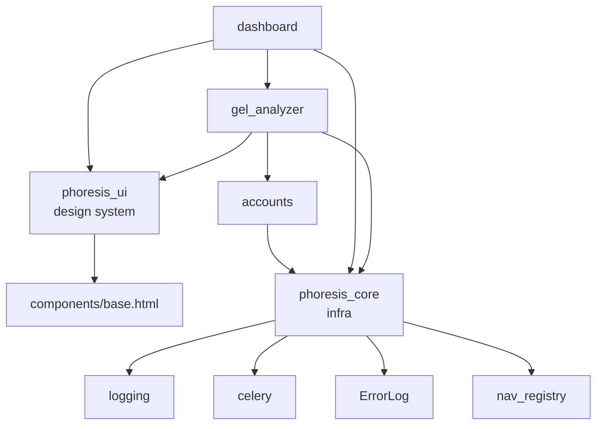
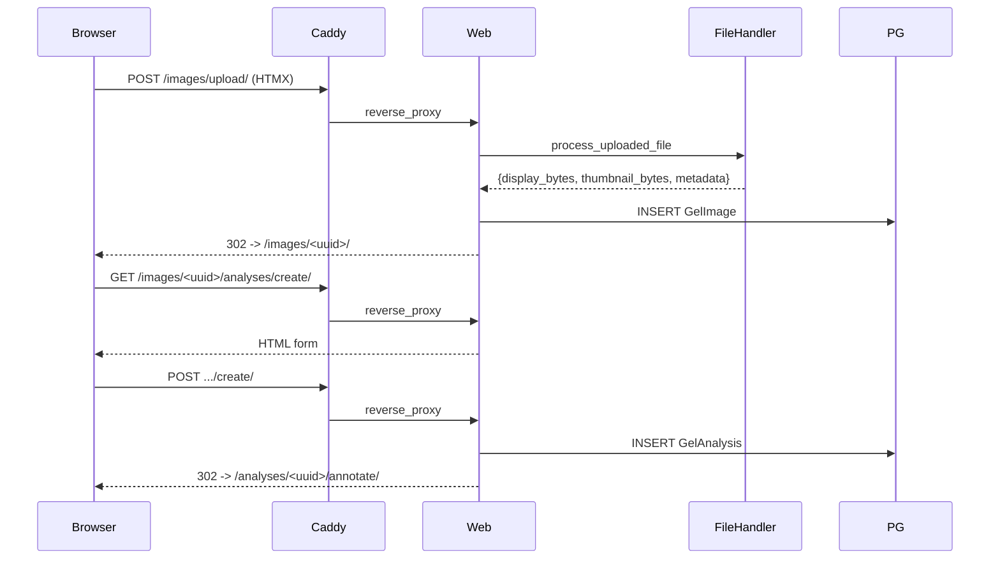
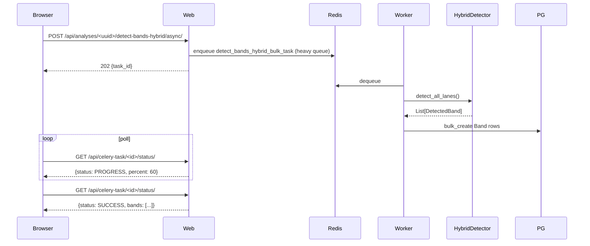
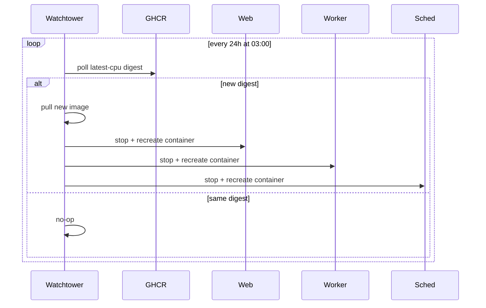
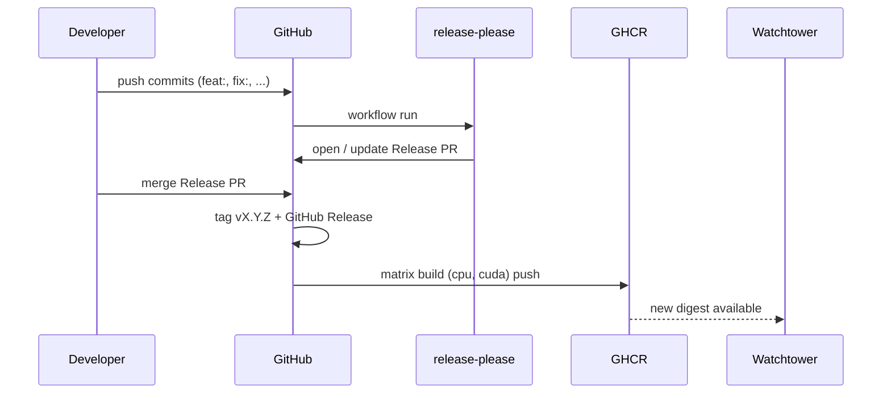

# Phoresis architecture

This document is the canonical reference for how the Phoresis pieces fit together. It covers the Django apps and their dependency direction, the runtime container layout, the two main user data flows (image upload and async hybrid band detection), the update / CI flow, and persistence.

## Overview

Phoresis is a single-user laptop deployment of a gel electrophoresis analyzer. It supports SDS-PAGE, Dot Blot, and Western Blot workflows, from raw image upload through lane and band annotation, densitometry, ladder calibration, and side-by-side comparison. It is designed to be installed and run on a single Windows 11 laptop (Docker Desktop + native PostgreSQL) by a wet-lab user with no DevOps background — the install script bootstraps everything end-to-end and the running stack is intended to keep working unattended for months at a time.

Phoresis was originally one app inside `ds-hub-django`, a multi-app internal lab platform that wrapped each tool inside a central `ProcessSample` registry. In Phase 1 the gel analyzer code was extracted into a standalone Django project, the central `ProcessSample` table and its registration plumbing were removed (the analyzer now owns its own `GelImage` and `GelAnalysis` aggregates with a thin optional `sample_metadata` JSON field), and the entire frontend was rebuilt from scratch on Tailwind 4 + a small `phoresis_ui` design-system app. The result is a focused, self-contained product that can ship a versioned Docker image and update itself in place.

The deployment surface is intentionally small: one container image (`web` / `worker` / `scheduler` all share the same image), one Caddy reverse proxy with self-signed TLS, one Redis broker, and Postgres on the host. The user-facing URL is `https://phoresis/` on the local machine. The DRF browsable API is mounted at `/api/v1/`. There is no multi-tenancy, no public internet exposure, and no horizontal scaling story.

## Apps & boundaries



The dependency direction is strict and one-way. `phoresis_ui` is leaf — it provides Django templatetags, the Tailwind build, the icon sprite, and a `components/base.html` partial, and it imports nothing from any feature app. `phoresis_core` provides cross-cutting infrastructure (loguru config, Celery setup, the `ErrorLog` model and `robust_task` decorator, and the `nav` registry that lets feature apps declare top-level navigation entries) and depends on no feature app.

`gel_analyzer` is the only feature app; it depends on `phoresis_core` (for `robust_task`, `ErrorLog`, and the nav registry), on `phoresis_ui` (for templatetags + base layout), and on `accounts` (for `User` and the lab-user permission group). `dashboard` is the only app that reaches into `gel_analyzer`, and it does so through a narrow read-only services lookup (counts of recent images / analyses for KPI cards). No app imports from `dashboard`. The result is that `gel_analyzer` could in principle ship as its own package; `dashboard` is pinned to whichever feature apps are installed.

## Container layout

```mermaid
graph TB
  subgraph Host["Host (Windows 11)"]
    PG[(PostgreSQL 17<br/>native)]
    MediaDir[(Media bind-mount<br/>%USERPROFILE%/Phoresis-Data/media)]
  end
  subgraph Docker["Docker Desktop / WSL2"]
    Caddy[Caddy 2<br/>:80 :443]
    Web[gunicorn<br/>4 workers]
    Worker[Celery worker<br/>queues: default heavy]
    Sched[Celery beat]
    Redis[(Redis 7)]
    WT[Watchtower]
  end
  Browser((Browser)) --> Caddy
  Caddy --> Web
  Web --> Redis
  Worker --> Redis
  Sched --> Redis
  Web -.host.docker.internal.-> PG
  Worker -.host.docker.internal.-> PG
  Web --> MediaDir
  Worker --> MediaDir
  Caddy -->|read-only| MediaDir
  WT -->|pull every 03:00| GHCR[(ghcr.io)]
```

PostgreSQL runs natively on the host (installed via `winget install PostgreSQL.PostgreSQL.17`), not in a container. This is deliberate: per the standalone design spec §9.1, `docker compose down -v` must never be able to wipe user data. By keeping the database (and the media bind-mount) outside the Docker volume namespace, the destructive `down -v` command can only ever remove regenerable state — staticfiles, the Redis AOF, and Caddy's self-signed CA. Containers reach the host Postgres via `host.docker.internal:5432`, which Docker Desktop exposes on Windows.

## Data flow — upload + analyze



The upload step is synchronous in the request cycle — `FileHandler.process_uploaded_file` reads the raw upload (TIFF, PNG, JPEG, or 16-bit grayscale), normalizes it to an 8-bit display variant + thumbnail, extracts EXIF / TIFF metadata, and writes the three files into `${PHORESIS_MEDIA_DIR}/gels/<uuid>/`. The synchronous path is acceptable because typical lab gels are 5-30 MB; larger images simply hold the request open. Creating an analysis is a pure DB insert with form-derived parameters (lane count, technique, ladder template) — the actual heavy work happens later, asynchronously, when the user runs band detection.

## Async hybrid band detection



The hybrid detector combines a classical CV pass (column profiling + peak finding with adaptive smoothing) with a learned correction step. Because a 12-lane gel can take 5-30 seconds to process, the detection endpoint never runs the work inline — it enqueues `detect_bands_hybrid_bulk_task` on the `heavy` queue (separate from the `default` queue so a long detection can't block, e.g., a quick thumbnail regeneration) and returns `202 {task_id}` immediately. The browser polls `/api/celery-task/<id>/status/` every 1 s; the task publishes intermediate progress (`current_lane / total_lanes`) via Celery's `update_state(state="PROGRESS", meta={"percent": ...})`. When the task finishes it bulk-inserts `Band` rows in a single round-trip and the next poll returns `SUCCESS` with the new band list.

## Watchtower update flow



Watchtower polls GHCR once per day at 03:00 local time for the digest of `:latest-cpu` (or `:latest-cuda` if `PHORESIS_IMAGE_VARIANT=cuda` is set in `.env`). When the digest changes, it pulls the new image and recreates the three containers labelled `com.centurylinklabs.watchtower.enable=true`: `web`, `worker`, and `scheduler`. Caddy and Redis intentionally do **not** carry that label — Caddy holds the self-signed root CA the user already trusted, and Redis holds in-flight Celery tasks. They get updated only when the user explicitly runs `scripts/update.ps1`, which does a full `docker compose pull && up -d`.

## CI/CD flow



The release flow is fully automated by `release-please`. Each `feat:` / `fix:` commit on `main` updates a draft "Release PR" that bumps the version, regenerates `CHANGELOG.md`, and tags the release on merge. The tag triggers a matrix Docker build (`cpu` and `cuda` variants) which pushes `:vX.Y.Z-{variant}` and `:latest-{variant}` to `ghcr.io/gmathy2104/phoresis`. From there Watchtower will pick the new image up at the next 03:00 poll on every installed laptop.

## Settings & secrets

`.env` is the single source of runtime configuration. It is generated interactively by `scripts/install.ps1` on first run (the script prompts for the admin email + password, the lab-user email + password, the Postgres password, and a randomly generated `DJANGO_SECRET_KEY`), it is `.gitignore`d, and it is read by both `docker-compose.yml` and `manage.py` via `django-environ`. Notable variables the user may override there:

- `PHORESIS_MEDIA_DIR` — host path for the media bind-mount (default `./_phoresis_data/media` under the install root)
- `PHORESIS_IMAGE_VARIANT` — `cpu` (default) or `cuda`
- `DJANGO_SECRET_KEY` — random 50-char string, generated on install
- `POSTGRES_PASSWORD` — set during `winget install` and re-entered on install
- Email + Celery worker concurrency overrides

The script never writes secrets to logs and never prints the generated `.env` contents to stdout.

## Volumes & persistence

| Volume | Type | Purpose | `down -v` wipes? |
|---|---|---|---|
| PostgreSQL data | host (native) | user data: gels, analyses, users | NO (lives outside Docker) |
| `${PHORESIS_MEDIA_DIR}` | host bind-mount | uploaded gel images, thumbnails, exports | NO |
| `phoresis_staticfiles` | named volume | collectstatic output | YES (regenerated on next start) |
| `phoresis_redis` | named volume | Celery broker AOF | YES (acceptable — only in-flight tasks lost) |
| `caddy_data` | named volume | self-signed root CA + certs | YES (regenerated; browser will warn once) |
| `caddy_config` | named volume | Caddy state | YES (regenerated) |

**`docker compose down -v` cannot wipe user data** — by design.
