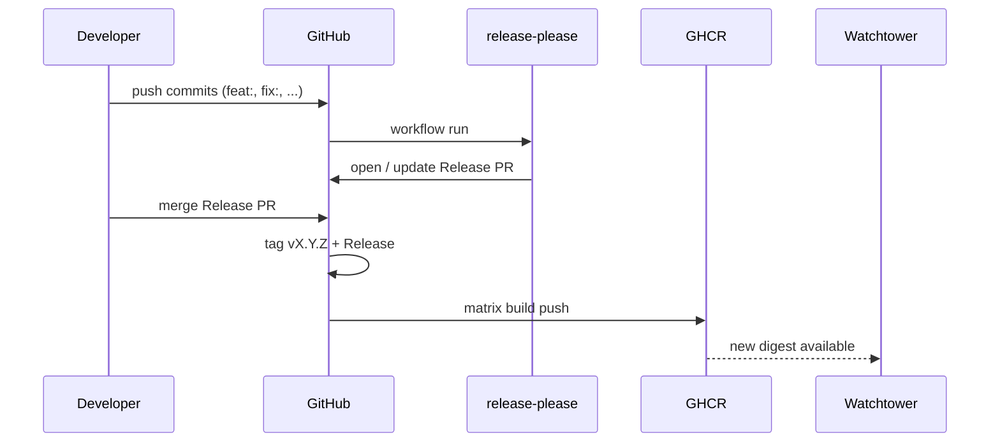

# Deployment guide

This guide covers everything that happens once code is merged to `main`: how releases get cut, how images get built and pushed to GHCR, how Watchtower updates a running install, how to roll back, how to back up and restore, and what to do when something on the running stack misbehaves.

For end-user installation, see [INSTALL.md](INSTALL.md). For the runtime container layout, see [ARCHITECTURE.md](ARCHITECTURE.md#container-layout).

## 1. Release flow

Every commit on `main` follows [Conventional Commits](https://www.conventionalcommits.org). `release-please` watches `main`, classifies each commit (`feat:` → MINOR, `fix:` → PATCH, `feat!:` / `BREAKING CHANGE:` → MAJOR), and keeps a draft "Release PR" up to date. Merging that PR:

1. Tags the repo `vX.Y.Z`.
2. Updates `CHANGELOG.md` with the curated release notes.
3. Triggers the `release.yml` GitHub Actions workflow.
4. The workflow runs a Docker matrix build (`cpu` and `cuda` variants) and pushes:
   - `ghcr.io/gmathy2104/phoresis:vX.Y.Z-cpu`
   - `ghcr.io/gmathy2104/phoresis:latest-cpu`
   - `ghcr.io/gmathy2104/phoresis:vX.Y.Z-cuda`
   - `ghcr.io/gmathy2104/phoresis:latest-cuda`
5. Creates a GitHub Release with the matching changelog excerpt.



There is no manual step. The maintainer's only judgement is "merge the Release PR, or wait for one more change".

## 2. Versioning

Phoresis follows [SemVer 2.0](https://semver.org):

- **MAJOR** (`X.0.0`) — breaking change to user data format, settings layout, or the deployment topology. Requires a documented migration.
- **MINOR** (`x.Y.0`) — backwards-compatible feature addition.
- **PATCH** (`x.y.Z`) — backwards-compatible bug fix or perf improvement.

Pre-1.0 the rules are slightly relaxed: `0.x.y` may include breaking changes on a MINOR bump. From `1.0.0` onward the strict rules apply.

## 3. Image variants

Two image variants are published per release:

| Tag | Base | Use |
|---|---|---|
| `:vX.Y.Z-cpu` / `:latest-cpu` | `python:3.12-slim` | default — works on any laptop |
| `:vX.Y.Z-cuda` / `:latest-cuda` | `nvidia/cuda:12.x-runtime` | optional — speeds up hybrid band detection if an NVIDIA GPU is present |

The user picks one in `.env`:

```bash
PHORESIS_IMAGE_VARIANT=cpu     # default
# or
PHORESIS_IMAGE_VARIANT=cuda
```

`docker-compose.yml` interpolates this into the image reference (`ghcr.io/gmathy2104/phoresis:latest-${PHORESIS_IMAGE_VARIANT}`), so a switch is a `.env` edit + `docker compose pull && up -d`.

## 4. Watchtower

Watchtower is included in the compose stack. It polls GHCR once per day at 03:00 local time (`WATCHTOWER_SCHEDULE: "0 0 3 * * *"`) for a new digest on `:latest-${PHORESIS_IMAGE_VARIANT}`. When it sees one, it pulls the new image and recreates the labelled containers in place.

**Scope** — Watchtower honors the `com.centurylinklabs.watchtower.enable` label and only touches:

- `web`
- `worker`
- `scheduler`

It explicitly does **not** touch `caddy` (which holds the trusted self-signed CA) or `redis` (which holds in-flight Celery tasks). Those are upgraded only when the user runs `scripts/update.ps1`.

Watchtower's logs go to `docker compose logs watchtower`; the schedule and scope can be overridden in `.env` via `WATCHTOWER_SCHEDULE` and `WATCHTOWER_INCLUDE_RESTARTING`.

## 5. Manual update

Runs the equivalent of "Watchtower right now, but for everything":

```powershell
.\scripts\update.ps1
```

This script pulls every image in `docker-compose.yml` (including Caddy and Redis), runs `docker compose up -d --remove-orphans`, prunes dangling images, and prints the resulting version of each container. It's safe to run any time — if no images changed, it's a no-op.

## 6. Rollback

If a release introduces a regression, pin to the previous version:

```powershell
.\scripts\update.ps1 -Rollback v1.2.3
```

Behind the scenes this writes `PHORESIS_IMAGE_TAG=v1.2.3-${variant}` into `.env` (overriding the `latest-` reference), runs `docker compose up -d`, and prints a reminder that **Watchtower is now disabled for this install** — because Watchtower only watches `:latest-*`, a pinned tag means no automatic upgrades will happen until the pin is removed (`scripts/update.ps1 -Unpin`).

User data is never affected by a rollback: the database is on the host and the media bind-mount lives outside Docker, so the only thing that changes is the running image.

## 7. Backup + restore

`scripts/backup.ps1` does a full backup (Postgres `pg_dump` + media bind-mount + `.env`) into a timestamped folder under `${PHORESIS_BACKUP_DIR}` (default: `%USERPROFILE%/Phoresis-Backups`). It is intended to be wired up to Windows Task Scheduler for daily automatic runs — see [INSTALL.md §11](INSTALL.md#11-backup-setup).

`scripts/restore.ps1` is interactive: it lists the available backups, prompts for which one to restore, stops the running stack, restores the database (`pg_restore --clean --if-exists`), restores the media bind-mount (`robocopy /MIR`), restores `.env`, and starts the stack back up. It always prompts for confirmation before doing anything destructive.

## 8. Healthchecks

| Endpoint | Returns | Used by |
|---|---|---|
| `GET /healthz/` | 200 if DB + Redis reachable + at least one Celery worker present, 503 otherwise | Caddy upstream gating |
| `GET /readyz/` | 200 if migrations applied + collectstatic ran, 503 otherwise | Compose `healthcheck` directive |
| Celery — `inspect ping` | per-worker pong | `/healthz/` worker check |

Caddy's `reverse_proxy` is configured with `health_uri /healthz/` and `health_interval 5s`. If a `web` container fails the check three times in a row, Caddy stops sending it traffic until it recovers. If `/healthz/` returns 503, the body lists which dependency is unhealthy (DB / Redis / workers) — that is the first place to look when the browser shows "502 Bad Gateway".

## 9. Logs

| Source | How to read |
|---|---|
| Each service's stdout / stderr | `docker compose logs <service>` (e.g. `docker compose logs -f web`) |
| Persistent file logs | host path `${PHORESIS_LOG_DIR}` (default `./_phoresis_data/logs`), bind-mounted into each container at `/var/log/phoresis/` |
| Caddy access log | `${PHORESIS_LOG_DIR}/caddy/access.log` |
| `ErrorLog` table | Django admin → `phoresis_core` → `Error logs` |

The `PHOR-` reference ID a user sees on the branded 500 page is the primary key of the matching `ErrorLog` row, so support requests pasting that ID get to the stack trace in one click.

## 10. Common troubleshooting

| Symptom | Likely cause | Fix |
|---|---|---|
| `https://phoresis/` shows cert warning | Caddy CA not trusted | Re-run `install.ps1` (it runs `Import-Certificate`) |
| Web container in `unhealthy` loop | Postgres unreachable | Check `pg_hba.conf` allows the Docker bridge subnet (typically `172.17.0.0/16`) |
| Worker stuck at "no workers" in `/healthz/` | Redis container not started | `docker compose up -d redis` |
| Pull fails on Watchtower | GHCR image went private, or rate-limited | Add `WATCHTOWER_AUTH_USERNAME` / `WATCHTOWER_AUTH_PASSWORD` to `.env` (PAT with `read:packages`) |
| Media files missing after upgrade | New install on a host with the legacy `phoresis_media` named volume | Re-run `install.ps1` — it auto-migrates the volume contents to `${PHORESIS_MEDIA_DIR}` |
| `docker compose up -d` fails with "address already in use :443" | Another service (Skype, IIS, another Caddy) is on 443 | Stop the conflicting service or override `PHORESIS_HTTPS_PORT` in `.env` |
| Slow band detection | CPU variant on a GPU laptop | Switch `PHORESIS_IMAGE_VARIANT=cuda` and `scripts\update.ps1` |
